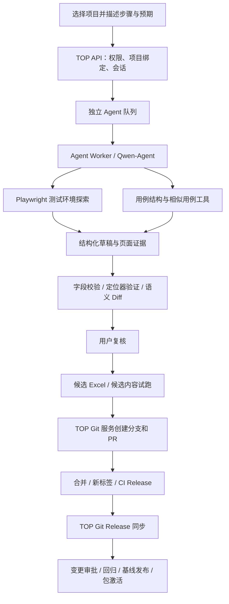

**TOP5 开发方案：Qwen-Agent 浏览器探索与 Excel 用例维护**

整理日期：2026-09-08（Asia/Shanghai）。来源：`top5` 对话 `01a0565e-8498-7bc3-ac56-5fd4cc10fea3`，重点为 9 月 8 日 09:26—11:18 的需求讨论，并结合当前 TOP / Web 仓库只读检查。

本文汇总对话中的需求和推荐路线，补充可实施的模块划分与验收条件。Agent 功能尚未实施；下文新增接口、数据对象和阶段均为开发建议。已有功能仅核对代码和文档，未重新验证当前部署、模型连通性或真实业务执行。

**1. 产品目标与对话结论**

用户在 TOP 选择项目，描述操作步骤和业务预期；AI 自动打开该项目的测试环境，探索页面、验证定位器、选择框架支持的操作与断言，并形成 Excel 用例草稿。用户查看差异后，由平台写入候选工作簿、试跑、提交 Git PR，再接入已有发布流程。

最近讨论收敛到采用官方 Qwen-Agent 作为执行框架，复用现有 Qwen 模型配置。现有 AI 助手的统计分析、失败分析、平台知识问答和历史对话继续保留。新增“用例生成/修改”入口，共用模型配置和用户身份体系。

| top5 的既有讨论 | 对本次开发的要求 |
| --- | --- |
| Web 脚本和 Excel 用例通过 Git 更新到 TOP | 以精确 tag、commit、基线摘要和镜像 digest 绑定版本；TOP 仓库与 Web 仓库分别管理 |
| A/B 双进程、两层重试、实时测试进度 | 候选试跑复用现有执行语义；页面区分 Agent 步骤、Run 轮次、用例数与执行次数 |
| 全量测试异常、磁盘被转储占满 | Agent 增加浏览器后，同样需要取消、进程回收、转储限制、日志与磁盘配额 |
| AI 全局分析与对话持久化 | 保留最近 10 次 Run 的分析口径；Agent 会话与任务状态也需要持久化 |
| AI 页面布局与模型自定义接入 | 沿用现有 UI 风格，顶部固定、对话独立滚动；模型选择复用配置中心 |
| 自然语言维护用例、浏览器自主探索 | 本次新增能力的主线 |

正式版本由当前激活自动化包解析，不能把历史讨论中的 `v1.0.0` 或 `v1.0.1` 写死为当前版本。

**2. 技术路线**

采用 `TOP → 独立 Agent Worker → Qwen-Agent → 受控 Playwright / 用例工具`。

Qwen-Agent 官方提供 Agent、模型适配、多轮工具调用、自定义工具和流式输出，可连接 OpenAI-compatible 服务。TOP 负责项目权限、任务持久化、浏览器与 Excel 工具、审核和发布。[官方仓库](https://github.com/QwenLM/Qwen-Agent)

`model_type=oai` 可用于文本模型；`use_raw_api`、上下文长度和思考参数应根据实际模型服务探测结果配置，不能沿用讨论中的固定 token 示例或假定所有模型兼容同一参数。[官方配置说明](https://qwenlm.github.io/Qwen-Agent/en/guide/get_started/configuration/)

首版使用 DOM、可访问性信息和页面文本完成探索。截图用于取证与人工复核；现有模型是否支持图片输入尚未验证，视觉理解作为后续能力。

复用 Qwen-Agent 库并保留 TOP 自有界面。BrowserQwen 的官方介绍侧重网页阅读、问答和内容创作；本项目需要另行开发 Playwright 操作与测试工具。[BrowserQwen 说明](https://github.com/QwenLM/Qwen-Agent/blob/main/browser_qwen.md)

**3. 用户工作流**

1. 选择项目及测试环境，平台自动读取绑定仓库、当前激活包对应的 commit、Excel 路径及基线。
2. 输入业务步骤、预期结果和修改范围；平台读取相似用例，生成任务范围。业务预期缺失时询问用户并等待，不自动补成当前页面表现。
3. 用户启动探索后，在任务授权范围内连续执行导航、查看、点击和输入，页面展示当前步骤、观察结果与失败原因。
4. Agent 生成定位器候选，验证匹配数量、可见性和可操作性，记录关联页面证据。
5. 生成结构化用例草稿并自动校验；展示新增、修改、停用的字段差异，允许用户调整或放弃。
6. 用户接受草稿后，平台的确定性工具修改临时工作簿，并对该候选内容进行指定用例试跑。
7. 用户选择创建 PR，由 TOP Git 服务提交已复核的内容；CI 失败信息回到同一会话供修正。
8. PR 合并并发布新 Git 标签，CI 生成不可变自动化包及 Release Manifest；TOP 沿用现有同步、审批和回归流程。

分析模式继续使用现有对话流程；用例生成任务拥有独立状态，不把普通聊天请求自动升级为文件修改任务。

**4. Excel 与执行框架适配**

已只读核对 Web 工作簿 `test_cases/test_case.xlsx` 的“自动化测试用例”主表，共 20 列。

| 字段 | 生成与维护责任 |
| --- | --- |
| 用例ID | 平台按项目规则分配，检查整张表的唯一性，包括停用用例 |
| 模块、测试场景、测试点、优先级 | 由需求及相似用例生成，用户可调整 |
| 前置条件、操作步骤 | 整理用户描述，并与实际探索轨迹对应 |
| 元素定位器、操作类型、输入数据、数据类型 | Agent 提出候选，工具验证并编码为现有执行器接受的格式 |
| 期望结果、验证点、断言类型、断言定位器 | 以明确的业务预期为依据，映射到框架注册表，验证断言目标 |
| 超时(秒)、备注、是否执行、执行分组 | 使用项目规则及受校验的建议值；停用通过执行标记表达 |
| 实际结果 | 新用例留空，由真实执行器回填；AI 不生成“通过”结果 |

内部草稿使用结构化步骤数组，保存 action、locator、data、assertion 和 evidence 引用，再由序列化工具映射到 Excel。模型不直接编辑 xlsx 二进制内容。

当前 Web 框架的关键限制：

- `step_executor.py` 使用逗号拆分操作和定位器、竖线拆分输入数据；含冲突分隔符的内容需要阻止写入或明确报为暂不支持。
- 执行器主要调用 `page.locator(字符串)`；探索时获取的 role、name、label 等信息必须转换为兼容的定位器表达式，不能把 Python 的 `get_by_role(...)` 调用直接写进单元格。
- 执行器部分路径使用 `.first`；Agent 校验必须额外拒绝多元素匹配，避免歧义被隐藏。
- 定位器优先选稳定测试属性、稳定 ID 和语义信息；验证时恢复相同前置状态后重放，不能在不同状态的页面上直接判断失效。
- 实际动作/断言白名单取自所绑定 commit 的 `case_validator.py`；当前本地检查为 15 个操作名、25 个断言名，后续按版本加载。
- 现有校验器会跳过停用行，平台草稿校验需要补充全表唯一性和结构检查。
- Excel 写入采用候选副本，检查未修改工作表、公式、样式和已有行；重新读取、校验及规范化成功后才允许生成提交内容。

业务预期与实际观察分别保存。例如需求要求“错误密码提示账号或密码错误”，页面却显示“系统异常”，应记录为预期不符，不允许把“系统异常”自动改成正确预期。

实现参考：[步骤执行器](../../../web_test/web/utils/step_executor.py)、[用例校验器](../../../web_test/web/utils/case_validator.py)。以上相对链接需从工作区外的 Web 仓库访问，实际本机路径为 `C:/Users/zengm/Desktop/自动化/web_test/web/`。

**5. 开发模块划分**

| 模块 | 可复用基础 | 新增交付 |
| --- | --- | --- |
| 模型接入 | `ai_provider_services.py`、`ai_gateway.py` | Qwen-Agent 模型适配器、工具能力探测、独立参数；既有分析 JSON 网关保留 |
| 项目配置 | 项目、环境、自动化包及基线 | 仓库绑定、Excel 路径、允许目录、环境域名、验证配置和预算 |
| 任务控制 | 现有 API 认证、数据库、审计、队列基础 | Agent 会话/任务/事件、取消/超时/恢复、事件流 |
| Agent Worker | 既有 Worker 隔离与资源限制设计 | 独立队列和容器执行边界、Qwen-Agent 循环、工具调度 |
| 浏览器探索 | Playwright 与既有测试环境绑定方式 | 浏览器会话、页面快照、操作工具、定位器验证、状态比较 |
| 用例工具 | Web 工作簿、注册表、基线规范化 | 结构化草稿、补丁、Excel 往返校验、字段 Diff |
| 候选验证 | 现有 Runner、结果与制品契约 | 用候选工作簿执行的隔离验证入口，绑定候选摘要 |
| Git 交付 | GitHub Release 读取与同步 | 服务端分支/commit/PR 写入、CI 状态关联、并发冲突检查 |
| 界面 | `AiAssistantView.vue`、项目设置及变更详情页 | 用例生成入口、任务进度、证据、可编辑草稿、Diff、PR/Run 状态 |

建议新增数据对象：`AgentProjectBinding`、`AgentSession`、`AgentTask`、`AgentEvent`、`CaseDraft`、`AgentApproval`。名称为暂定，不与现有只读聊天表混用任务状态。

每个任务固定保存：项目/环境、发起人、模型配置标识与非秘密参数快照、Git 基准 commit、包与基线摘要、工具版本、候选内容摘要、任务状态、事件序号和后续 PR/Run/Change Request 关联。凭据以服务端引用保存。

建议 API 能力包括：项目 Agent 配置、创建/读取会话、创建任务、读取事件、取消任务、提交澄清、获取/修订草稿、接受指定摘要的草稿、候选验证、创建 PR。均执行项目权限检查；重复请求通过幂等键避免重复提交和重复 PR。

任务状态建议为：`QUEUED → EXPLORING → DRAFT_READY → VALIDATING → REVIEW_READY → PR_CREATED`，按需要进入 `WAITING_INPUT`、`FAILED`、`CANCELLED`、`TIMED_OUT`。Git 合并和 TOP 发布状态由关联对象展示，不把长时间等待发布当成持续运行的浏览器任务。

**6. 候选验证与正式发布**

候选试跑必须使用本次改动后的 Excel/代码内容。当前激活镜像内的工作簿属于旧版本，直接在旧包上执行新增用例无法证明新候选可运行。

建议在隔离验证 Worker 内，从固定基准提交构建候选工作副本，应用已确认补丁，执行所选用例并保存候选摘要、结果和制品。该结果用于开发验证；正式包的准入和发布仍使用不可变镜像的独立验证结果。

发布路径沿用现有约定：

`PR 合并 → 新 Git 标签 → CI 镜像/基线/Manifest → TOP 同步预览 → 创建草稿 → 供应链准入 → 受影响用例验证 → 提交与异人审批 → 候选全量回归 → 发布基线 → 自动化包全量验证 → 激活包`

有用例变化时提升基线版本；包含新 Excel 的 Web 发布也必须有新的不可变发布身份。Web Release 版本和 Case Baseline 版本独立维护，不能混用或覆盖已有版本。

提交前检查远端目标分支是否变化；发生冲突时重新生成差异并复核。用户接受的是具体内容摘要，任何后续修改都会使旧确认失效。

依据：[Git Release 同步](../operations/git-release-sync.md)、[用例治理状态机](../milestones/M3-identity-governance-frontend.md)、[现有 Pytest 执行契约](../milestones/M10.3-central-legacy-pytest-execution.md)。

**7. 工具与运行边界**

| 工具组 | 首版范围 |
| --- | --- |
| 项目与用例 | `get_project_context`、`find_similar_cases`、读取字段及动作/断言注册表 |
| 浏览器 | 启停会话、导航、页面快照、获取元素、点击、输入、选择、等待、比较页面状态 |
| 定位器 | 生成候选、检查唯一性/可交互性、在相同前置状态下复验 |
| 草稿 | 构建/修订结构化用例、校验、展示语义差异 |
| TOP 后端动作 | 已接受补丁写入候选 Excel、触发候选试跑、创建 PR |

项目级策略限制工具可访问的环境、操作和文件。浏览器和模型调用运行在专用任务环境；模型只看到脱敏观察，不接收测试密码、Cookie、Git Token 或模型 API Key。测试登录由受控工具使用短期绑定凭据完成，模型客户端在服务端读取认证配置。

用户启动任务时确定可执行的测试操作，允许范围内连续推进；缺少业务预期时等待澄清，超出授权范围的业务写操作才升级确认。删除、支付及正式发布等行为不开放为首版探索工具。

网页文本和仓库内容是任务数据，不能改变工具权限。网络限制应覆盖导航和重定向；日志、页面快照和截图需要在进入模型上下文前脱敏。

Agent 不获得任意 Shell、任意文件写入、Git 推送凭据、Docker Socket 或数据库账号。平台为每个任务设置时间、工具轮数、token、CPU/内存、磁盘与制品上限；取消后回收浏览器、进程和临时副本，保留必要审计证据。

重启后恢复任务状态和记录；浏览器失效时重新建立会话并恢复明确前置条件。副作用不明确的步骤禁止盲目重试，标记待人工判断。

**8. 分阶段实施与验收**

| 阶段 | 交付范围 | 完成标准 |
| --- | --- | --- |
| P0：能力验证 | 固定 Qwen-Agent 版本；用现有模型测试单次/连续工具调用、错误恢复、结构化输出 | 连续至少 5 轮工具调用可完成并可追踪；错误参数可修正；未知工具被拒绝；记录时延与 token，不以普通聊天成功代替验收 |
| P1：探索与草稿 MVP | 项目绑定、独立 Worker、受控 Playwright、草稿、20 列映射、会话/事件及 Diff | 选 10 条现有用例评测；每条有证据和字段对照，所有接受的草稿静态校验通过，单目标定位器唯一；不明预期等待输入 |
| P2：候选编辑与试跑 | Excel 补丁写入、样式/公式保护、整表检查、候选验证、取消与恢复 | 新增/修改/停用均可完成；试跑结果绑定真实候选摘要；正式工作簿保持不变；刷新后任务不丢失 |
| P3：Git 与发布闭环 | 分支/PR、CI 回传、冲突检查、Release 与 TOP 变更关联 | 端到端完成一个真实候选从 PR 到正式包激活的验证；失败和拒绝路径保留当前正式版本 |
| P4：扩展 | 与用例相关的小范围脚本修改、更多页面类型、可选视觉模型与执行引擎 | 分别建立评测集和文件白名单后开放，不把首版结果推广到任意项目修改 |

10 条评测用例优先覆盖登录、搜索、筛选、列表和详情；加入重复定位器、页面暂态、预期不明等失败情形。用例选择需要符合测试环境实际授权。统计首次成功率、人工修订量、试跑通过率、耗时和 token，用结果决定是否扩大范围。

进入 P2 前，应满足接受草稿字段校验 100% 通过、受测单目标定位器验证通过、无越权操作、未把异常观察写为正确预期。发现产品缺陷的用例可以正确失败，不能为追求通过率修改业务预期。

今天最适合开始的三个开发任务：

1. 明确 Agent 项目绑定和结构化草稿契约，复用 Web 当前字段、注册表及序列化规则。
2. 建立 Qwen-Agent 的最小独立执行器，使用模拟工具验证现有 Qwen 的连续工具调用与错误恢复。
3. 接入一个允许访问的测试页面，完成“观察 → 定位器验证 → 单条用例草稿 → Diff”的最小闭环，再扩展到 10 条评测。

**9. 需要配置的信息与未验证项**

一次性配置：项目对应 Web Git 仓库、默认分支、Excel 路径、允许修改范围、测试环境、测试账号引用、校验与试跑命令、Git 服务凭据引用、评审人、Agent 模型及资源预算。能从项目和激活包推导的值由平台读取。

每次任务主要提供：项目、要新增/修改/停用的内容、操作步骤、业务预期和特殊测试数据约束。优先级等非关键项可给出可编辑建议，正确性依赖的缺失信息需要用户回答。

当前未验证：既有 Qwen 服务的连续工具调用可靠性、图片输入能力、真实页面探索成功率、Agent 并发资源占用，以及本次新增流程的部署状态。当前 TOP 有未提交的 AI/UI 工作区变更；实施时应形成独立可审查的改动，避免与已有工作混合。

本次仅新增开发方案文档，未安装 Agent、修改业务代码、调用用户模型、操作测试页面或执行发布。
